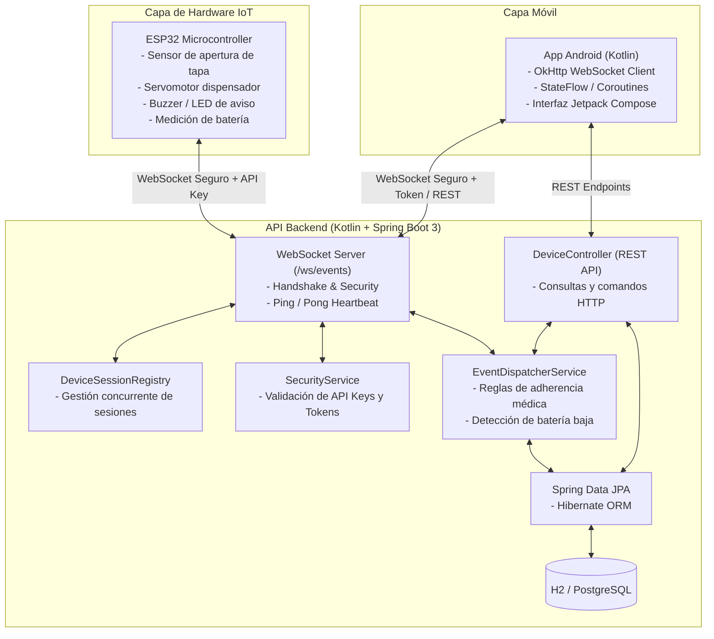
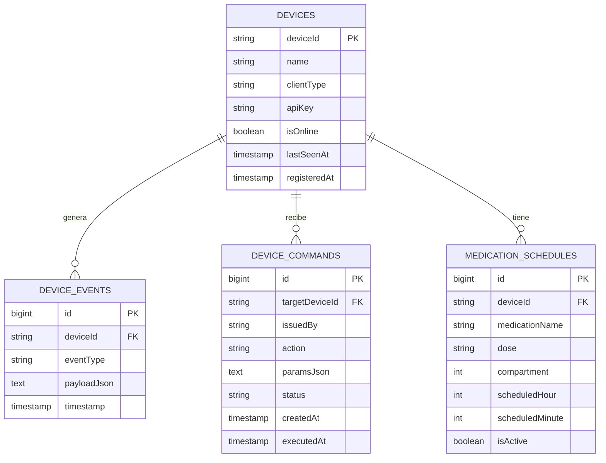

# Documentación Técnica Integral - MeddiBudy API Sockets

## 1. Visión General del Proyecto
**MeddiBudy-Api-Sockets** es una plataforma orientada a eventos construida en **Kotlin** con **Spring Boot 3** y **Java 21**. Su objetivo es orquestar la comunicación bidireccional y en tiempo real entre hardware embebido (**ESP32**, que actúa como pastillero inteligente con sensores y dispensadores) y aplicaciones móviles (**Android** para pacientes, familiares y médicos).

---

## 2. Arquitectura del Sistema



---

## 3. Protocolo WebSocket (`/ws/events`)

### Conexión y Handshake
Los clientes pueden conectarse directamente con parámetros en la URL o autenticarse mediante el mensaje `CONNECT`:

* **URL para ESP32:**
  ```text
  ws://<HOST>:8080/ws/events?deviceId=ESP32_MED_01&clientType=ESP32&apiKey=meddibuddy-secret-esp32-key-2026
  ```
* **URL para Android:**
  ```text
  ws://<HOST>:8080/ws/events?deviceId=USER_ANDROID_01&clientType=ANDROID&token=meddibuddy-jwt-secret-android-token-2026
  ```

---

### Formato Estándar de Mensajes JSON
Todos los paquetes transmitidos por el WebSocket cumplen la siguiente especificación:

```json
{
  "type": "CONNECT | SUBSCRIBE | UNSUBSCRIBE | TELEMETRY | ALERT | COMMAND | COMMAND_ACK | PING | PONG",
  "deviceId": "string (Identificador del emisor)",
  "clientType": "ESP32 | ANDROID | WEB | SERVER",
  "targetDeviceId": "string (Opcional, identificador del destinatario)",
  "timestamp": "ISO-8601 (Ej. 2026-11-01T20:00:00Z)",
  "payload": {
    "clave": "valor"
  },
  "messageId": "string (Opcional)"
}
```

---

### Catálogo de Eventos

| Tipo de Mensaje | Emisor | Receptor | Descripción | Ejemplo de Payload |
| :--- | :--- | :--- | :--- | :--- |
| `CONNECT` | ESP32 / Android | Servidor | Saludo inicial y registro de metadatos | `{"firmware": "1.0", "apiKey": "..."}` |
| `SUBSCRIBE` | Android | Servidor | Suscribe la app a eventos de un ESP32 | `{"targetDeviceId": "ESP32_MED_01"}` |
| `TELEMETRY` | ESP32 | Servidor $\rightarrow$ Android | Envío periódico de estado de sensores | `{"battery": 95, "pillBoxClosed": true, "temp": 23.5}` |
| `ALERT` | ESP32 / Servidor | Android | Notificación crítica en tiempo real | `{"alertType": "MEDICATION_TAKEN", "compartment": 1}` |
| `COMMAND` | Android / REST | Servidor $\rightarrow$ ESP32 | Orden hacia el hardware | `{"action": "DISPENSE_MEDICATION", "compartment": 1}` |
| `COMMAND_ACK` | ESP32 | Servidor $\rightarrow$ Android | Confirmación física de comando ejecutado | `{"executedAction": "DISPENSE", "status": "SUCCESS"}` |
| `PING` / `PONG` | Ambos | Ambos | Latido para verificar conexión activa | `{"timestamp": "..."}` |

---

## 4. Reglas de Negocio Automatizadas en la API

1. **Detección Automática de Adherencia:**
   * Cuando el ESP32 envía telemetría indicando `pillBoxOpened: true` o `pillBoxClosed: false`, el servidor genera inmediatamente un evento `ALERT` de tipo `MEDICATION_TAKEN` con el compartimento correspondiente y lo envía a la app Android del cuidador/familiar.
2. **Detección de Batería Baja:**
   * Si la telemetría reporta `battery < 20%`, el servidor dispara una alerta `LOW_BATTERY` alertando sobre la necesidad de recarga.
3. **Persistencia y Auditoría de Comandos:**
   * Todo comando enviado se persiste en estado `PENDING` o `SENT`.
   * Al recibir el `COMMAND_ACK` del ESP32, el registro se actualiza a `EXECUTED` con la marca de tiempo exacta de ejecución en hardware.

---

## 5. Modelo de Datos y Persistencia (JPA)

La base de datos almacena:



---

## 6. Referencia de la API REST (`/api/v1/devices`)

### Dispositivos
* **`GET /api/v1/devices`**
  * Retorna la lista de todos los dispositivos registrados, su clave, estado en línea (`isOnline`) y última vez vistos (`lastSeenAt`).

### Historial de Eventos
* **`GET /api/v1/devices/{deviceId}/history?limit=50`**
  * Retorna los últimos $N$ eventos (telemetrías, alertas, confirmaciones) del dispositivo.

### Auditoría de Comandos
* **`GET /api/v1/devices/{deviceId}/commands?limit=20`**
  * Retorna el historial de comandos emitidos al dispositivo con su estado (`SENT`, `EXECUTED`, `FAILED_OFFLINE`).

### Envío de Comandos Directos
* **`POST /api/v1/devices/{deviceId}/command`**
  * Envía una acción directa al ESP32 vía HTTP.
  * **Body:**
    ```json
    {
      "action": "DISPENSE_MEDICATION",
      "params": {
        "compartment": 1
      }
    }
    ```

### Horarios de Medicamentos
* **`GET /api/v1/devices/{deviceId}/schedules`**
  * Lista los recordatorios y horarios activos para el dispositivo.
* **`POST /api/v1/devices/{deviceId}/schedules`**
  * Agrega una nueva programación médica:
    ```json
    {
      "medicationName": "Paracetamol 500mg",
      "dose": "1 tableta",
      "compartment": 1,
      "scheduledHour": 14,
      "scheduledMinute": 30
    }
    ```

---

## 7. Guía de Conexión de Hardware (ESP32)

### Componentes Físicos Sugeridos:
* **Microcontrolador:** ESP32 NodeMCU / ESP32-WROOM-32.
* **Actuador de Dispensación:** Servomotor SG90 (Pin GPIO 19).
* **Alarma Sonora:** Buzzer pasivo o activo (Pin GPIO 18).
* **Sensor de Tapa:** Interruptor de lámina magnética (Reed Switch) o sensor de efecto Hall (Pin GPIO 4).
* **Sensor de Batería:** Divisor de tensión al pin analógico ADC (GPIO 34).

### Firmware de Ejemplo:
El archivo [`docs/esp32_example.ino`](docs/esp32_example.ino) contiene la implementación completa para Arduino IDE o PlatformIO utilizando:
1. `WiFi.h`: Conexión de red.
2. `WebSocketsClient.h`: Conexión WebSocket persistente con auto-reconexión.
3. `ArduinoJson.h`: Parseo y serialización ligera en memoria.

---

## 8. Guía de Conexión en Android (Kotlin)

El archivo [`docs/android_kotlin_example.kt`](docs/android_kotlin_example.kt) provee la clase `AndroidWebSocketManager`:
* Utiliza **OkHttp WebSocket** optimizado para Android.
* Emite mensajes recibidos a un `SharedFlow<DeviceMessage>` reactivo listo para ser consumido en un `ViewModel` y renderizado con **Jetpack Compose**.
* Implementa ping/pong automático cada 20 segundos para evitar que el sistema operativo mate la conexión por inactividad.

---

## 9. Pruebas y Simuladores

* **Ejecutar Pruebas Automatizadas:**
  ```bash
  ./gradlew test
  ```
* **Levantar la API en Desarrollo:**
  ```bash
  ./gradlew bootRun
  ```
  *(La base de datos H2 se iniciará automáticamente en memoria y la consola estará disponible en `http://localhost:8080/h2-console`).*
* **Probar con Simuladores Python:**
  ```bash
  # En una terminal:
  python3 scripts/simulate_esp32.py

  # En otra terminal:
  python3 scripts/simulate_android.py
  ```
* **Levantar PostgreSQL en Docker (Producción):**
  ```bash
  docker compose up -d
  ```
