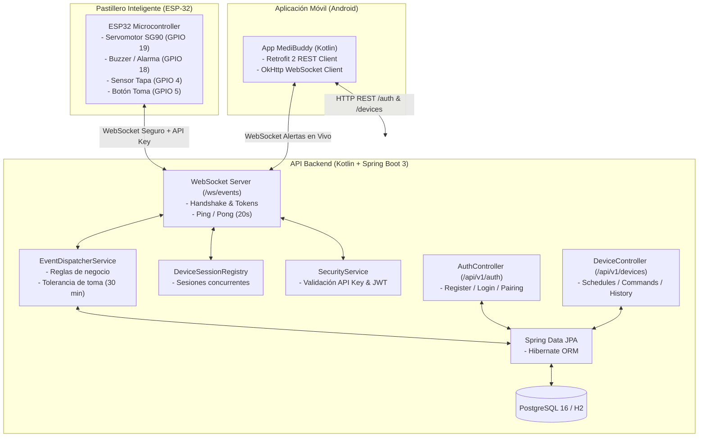

# MediBuddy API & WebSocket Server (Kotlin / Spring Boot 3)

Servidor backend y plataforma orientada a eventos construida en **Kotlin** con **Spring Boot 3** y **Java 21**. Su objetivo es coordinar la comunicación en tiempo real entre el pastillero inteligente con hardware embebido (**ESP-32**) y la aplicación móvil (**MediBuddy Android**), ofreciendo persistencia de datos, reglas de negocio médicas y seguridad.

---

## 🏗️ Arquitectura del Sistema



---

## ⚙️ Configuración y Variables de Entorno (`.env`)

El backend es **100% modular**. Todas las credenciales, puertos y configuraciones se cargan desde variables de entorno. 

El archivo preconfigurado [`.env`](.env) contiene los valores listos para desarrollo local:

| Variable | Descripción | Valor por Defecto |
| :--- | :--- | :--- |
| `PORT` | Puerto HTTP del servidor Spring Boot | `8080` |
| `POSTGRES_DB` | Nombre de la base de datos PostgreSQL | `meddibuddy` |
| `POSTGRES_USER` | Usuario de base de datos PostgreSQL | `meddibuddy` |
| `POSTGRES_PASSWORD` | Contraseña de base de datos PostgreSQL | `meddibuddy_password` |
| `POSTGRES_PORT` | Puerto de PostgreSQL expuesto por Docker | `5432` |
| `MEDDIBUDDY_API_KEY` | Clave maestra para autenticar dispositivos ESP-32 | `meddibuddy-secret-esp32-key-2026` |
| `MEDDIBUDDY_JWT_SECRET` | Secreto maestro para tokens de Android | `meddibuddy-jwt-secret-android-token-2026` |
| `H2_CONSOLE_ENABLED` | Habilita consola H2 en `/h2-console` | `true` |

---

## 🚀 Inicio Rápido

### Requisitos
- **JDK:** Java 21 instalado (`java -version`).
- **Docker y Docker Compose:** Para ejecutar PostgreSQL.
- **Python 3:** *(Opcional)* para ejecutar simuladores de hardware.

---

### Opción 1: Levantar con PostgreSQL en Docker (Recomendado)

```bash
# 1. Iniciar el contenedor de PostgreSQL 16
docker compose up -d

# 2. Iniciar la API con el perfil postgres
./gradlew bootRun --args='--spring.profiles.active=postgres'
```

> **Herramienta visual pgAdmin (Opcional):**  
> Si deseas administrar la base de datos visualmente en `http://localhost:5050`, levántalo con:  
> `docker compose --profile tools up -d`  
> *(Credenciales: `admin@meddibuddy.com` / `admin1234`)*.

---

### Opción 2: Levantar con Base de Datos H2 en Memoria (Prueba Inmediata sin Docker)

```bash
./gradlew bootRun
```
*La base de datos se creará en memoria y la consola web estará en: `http://localhost:8080/h2-console` (JDBC URL: `jdbc:h2:mem:meddibuddy_db`, Usuario: `sa`, Contraseña vacía).*

---

### Opción 3: Ejecutar la Suite de Pruebas Automatizadas

```bash
./gradlew test
```
*Ejecuta pruebas unitarias y de integración para autenticación, reglas de negocio de medicamentos y flujo de eventos.*

---

## 📚 Catálogo de Endpoints REST

### 1. Módulo de Autenticación (`/api/v1/auth`)

* **`POST /api/v1/auth/register`**: Registra un nuevo usuario con perfil (`CUIDADOR` o `ADULTO_MAYOR`). Contraseña protegida con SHA-256.
  ```json
  {
    "name": "Laura Cuidadora",
    "email": "cuidadora@test.com",
    "password": "password123",
    "role": "CUIDADOR"
  }
  ```
* **`POST /api/v1/auth/login`**: Valida credenciales y emite el token de sesión.
* **`POST /api/v1/auth/pairing/generate`**: El cuidador genera un código de vinculación de 6 dígitos (válido por 15 minutos).
* **`POST /api/v1/auth/pairing/link`**: El adulto mayor ingresa el código de 6 dígitos para asociar ambos dispositivos.

---

### 2. Módulo de Dispositivos y Medicamentos (`/api/v1/devices`)

* **`GET /api/v1/devices`**: Lista todos los dispositivos registrados y su estado en línea (`isOnline`).
* **`GET /api/v1/devices/{deviceId}/schedules`**: Obtiene los medicamentos activos para el pastillero.
* **`POST /api/v1/devices/{deviceId}/schedules`**: Programa un nuevo medicamento:
  ```json
  {
    "medicationName": "Losartán 50mg",
    "dose": "1 tableta",
    "compartment": 1,
    "scheduledHour": 20,
    "scheduledMinute": 0
  }
  ```
* **`PUT /api/v1/devices/{deviceId}/schedules/{scheduleId}`**: Actualización médica. Protegida por regla de negocio: solo el rol `CUIDADOR` puede modificar dosis u horarios.
* **`DELETE /api/v1/devices/{deviceId}/schedules/{scheduleId}`**: Borrado lógico (`isActive = false`). Solo permitido para `CUIDADOR` para mantener la trazabilidad histórica.
* **`PATCH /api/v1/devices/{deviceId}/schedules/{scheduleId}/status`**: Actualiza el estado de la dosis (`PENDIENTE`, `DISPENSADA`, `TOMADA`, `POSPUESTA`, `TARDIA`, `ERROR`).
* **`POST /api/v1/devices/{deviceId}/command`**: Envía una orden directa al pastillero:
  ```json
  {
    "action": "DISPENSE_MEDICATION",
    "params": { "compartment": 1 }
  }
  ```
* **`GET /api/v1/devices/{deviceId}/history`**: Historial de los últimos eventos del dispositivo.
* **`GET /api/v1/devices/{deviceId}/commands`**: Historial de comandos enviados y estado de ejecución física.

---

## 📡 Protocolo WebSocket (`/ws/events`)

### Conexión Handshake
- **ESP-32:** `ws://<HOST>:8080/ws/events?deviceId=ESP32_MED_01&clientType=ESP32&apiKey=meddibuddy-secret-esp32-key-2026`
- **Android:** `ws://<HOST>:8080/ws/events?deviceId=USER_ANDROID_01&clientType=ANDROID&token=...`

### Estructura Estándar de Mensaje JSON
```json
{
  "type": "CONNECT | SUBSCRIBE | TELEMETRY | ALERT | COMMAND | COMMAND_ACK | PING | PONG",
  "deviceId": "string (Emisor)",
  "clientType": "ESP32 | ANDROID | SERVER",
  "targetDeviceId": "string (Opcional, receptor)",
  "payload": {
    "clave": "valor"
  }
}
```

### Reglas de Negocio Automatizadas en el Servidor
1. **Detección Automática de Adherencia:** Cuando el ESP32 envía una alerta física de botón presionado (`buttonPressed: true`), el backend calcula si la toma ocurrió dentro de la ventana de tolerancia (30 min) y transiciona el estado a `TOMADA` o `TARDIA`, notificando de inmediato a la app del cuidador.
2. **Detección de Batería Baja:** Si la telemetría reporta batería menor a 20%, se genera una alerta prioritaria `LOW_BATTERY` dirigida al cuidador.

---

## 🧪 Pruebas y Simuladores

1. **Guía Rápida de Comandos cURL**:  
   Consulta [PRUEBAS_API_CURL.md](../PRUEBAS_API_CURL.md) con el ciclo completo de comandos para copiar y pegar.
2. **Simuladores en Python**:
   ```bash
   # En una terminal (simula el pastillero físico):
   python3 scripts/simulate_esp32.py

   # En otra terminal (simula la app Android):
   python3 scripts/simulate_android.py
   ```

---

## 📚 Documentación Técnica Detallada
- [GUIA_INTEGRACION_API_APP_ESP32.md](../GUIA_INTEGRACION_API_APP_ESP32.md): Manual completo con esquemas para ESP32, despliegue en servidor (Docker/Nginx) y diagramas.
- [DOCUMENTATION.md](DOCUMENTATION.md): Documentación de arquitectura interna.
- [REPORTE_CAMBIOS.md](../REPORTE_CAMBIOS.md): Registro histórico de cambios del proyecto.
